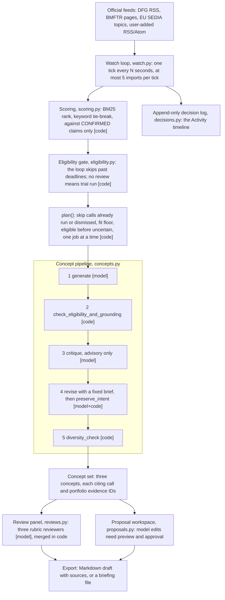

# GrantBridge

**Who it helps:** researchers with no time to watch funding portals. GrantBridge finds new calls
on its own, ranks them against what the researcher has confirmed they can do, and drafts three
project concepts for the best match, each citing the call and the researcher's own evidence.

It is a long-running agent. It watches the official German funding feeds (DFG, BMFTR) and
re-checks the EU Horizon Europe topics you list. Eligibility is gated by deterministic code,
not by the model, and generation runs on a local Ollama model, so unpublished work never goes to
a hosted API.

## At a glance

- **It runs end to end, unattended.** One command starts the API and the watch loop. From a fresh
  clone, the first tick imports new notices, ranks them and finishes a five-stage concept run in
  about two minutes on a laptop, on either default model. [What the first tick
  does](#what-the-first-tick-does) shows a real one.
- **It is more than one prompt.** A long-running loop (`watch.py`) uses tools: the funders' feeds
  and pages, the EU portal's search API, and a local LLM. Each run is a five-stage pipeline: three
  model calls and two code checks. The agent keeps its memory on disk, in every run's record and
  in an append-only decision log it also reads. It never repeats a call it already worked on, and
  it skips calls the researcher dismissed. A three-reviewer panel critiques any concept on request.
- **The model proposes, code verifies.** Only claims the researcher confirmed ever reach the
  model. Every citation must name a passage the model was actually given. The model's critique
  is never applied automatically, and a revision cannot change the research question.
- **The output is something to act on.** Each concept has a hypothesis, why it fits this call,
  why this researcher can do it, and what they would still need. One is shown below, verbatim.

## What makes it different

- **It does not invent expertise.** Every portfolio claim has a review status: confirmed,
  inferred, needs review or missing. Only confirmed, included claims are scored or shown to the
  model (`usable()` in `src/grant_recommender/portfolio.py`). Everything else stays withheld
  until the researcher confirms it. With no confirmed claim, the watch loop idles and generation
  refuses to start.
- **Eligibility is a separate, deterministic check, not a similarity score.** It uses the
  recorded deadlines and a researcher review that is hashed to the exact call and portfolio
  snapshot, so editing either one invalidates the review (`eligibility.py`). The watch loop and
  the terminal apps never develop a call whose deadlines have all passed. A trial started by
  hand in the web UI can, and stays labelled a trial.
- **Only three of the five pipeline stages call the model.** `generate`, `critique` and `revise`
  are Ollama calls. `check_eligibility_and_grounding` (schema and citation-ID check) and
  `diversity_check` (pairwise keyword overlap) are ordinary code (`STAGE_NAMES` in
  `concepts.py`).
- **The model's critique is never applied automatically.** The raw critique is kept for the
  researcher to read. The revision model gets a fixed, safe brief instead
  (`product_grounding.safe_revision_critique`).
- **Revision cannot rewrite the research question.** `product_grounding.preserve_intent` rejects
  a revision that changes concept IDs. It also restores each concept's title, problem,
  hypothesis, objectives and novelty word for word, and records every field it restored.
- **The watch loop runs unattended and leaves an audit trail.** Each tick refreshes the feeds,
  imports new notices, rescores the watch list, applies the eligibility gate and starts at most
  one run (`watch.py`). It skips calls the researcher dismissed. Each run it starts is recorded
  as the watcher's in the same append-only decision log as the researcher's own decisions, where
  an undo is a new event and never an edit (`decisions.py`).
- **The review panel has no chair model.** Three rubric reviewers (methods, feasibility, fit to
  the call) read a concept in parallel. Code merges their verdicts, and the worst verdict wins
  (`reviews.consolidate`). A summary of reviews cannot invent a criticism nobody made.

## How it works



One process (`scripts/serve_grantbridge.py`) runs the FastAPI server (`api.py`) on
127.0.0.1:8010 and, with `--watch`, the loop in a background thread. The React UI in `web/` and
the two terminal apps read and write the same local stores. A run started from a terminal app
shows up in the web UI after the API restarts.

## Quickstart

Prerequisites:

- Python 3.13 and [uv](https://docs.astral.sh/uv/) 0.11 or later. uv downloads Python 3.13 if it
  is missing.
- Node.js 22.12 or later, for the web UI.
- [Ollama](https://ollama.com) and the default model for your platform, for generation only.
  Use the full tag, because the health check matches the exact name:
  - macOS on Apple silicon: `ollama pull gemma4:12b-mlx`
  - Linux (including NVIDIA GPUs), Intel Macs and Windows under WSL: `ollama pull qwen3:4b-instruct-2507-q4_K_M`
  - Override with `--model <tag>` or `OLLAMA_MODEL`. A connection saved under **Connection
    settings** in the web UI, or picked with `m` in the terminal app, takes precedence until you
    choose **Restore launcher settings**.
- Internet access for the official feeds.

Install and test. Plain `uv sync` installs the API, both terminal apps and the test tools. It
resolves 45 packages and does not include torch.

```sh
uv sync
uv run pytest -q
```

Load the invented example portfolio. The second line never overwrites a portfolio you already
have:

```sh
mkdir -p data/private
[ -f data/private/portfolio.json ] || cp data/example_portfolio.json data/private/portfolio.json
```

Start the API with the watch loop, one tick every 60 s. Pull the model first. Without it the loop
still discovers and ranks calls, but it logs `Model not ready` and waits instead of starting a
run that could only fail:

```sh
uv run python scripts/serve_grantbridge.py --watch 60
```

In a second terminal, start the web UI and open http://127.0.0.1:5173:

```sh
cd web && npm ci && npm run dev
```

The terminal apps read the same stores:

```sh
uv run python -m grant_recommender.tui   # review panel: pick a concept, press r
uv run python -m grant_recommender.app   # workspace: s scrape, a add a feed, e extract facts, w briefing
```

The review panel and briefings exist only in the terminal apps. Past applications, eligibility
review and the proposal workspace exist only in the web UI.

### What the first tick does

The example is an invented researcher in metabolic health and wearable glucose biomarkers. **My
profile** shows 4 confirmed claims ready for the model and 2 withheld, and "See exactly what gets
sent" lists only the 4. On the first tick the loop imports up to five new DFG/BMFTR notices,
ranks them together with the EU topic in `data/watched_topics.json`, and develops the
top-ranked call. No call has an eligibility review yet, so that run is an exploratory trial.
The first tick of a fresh clone:

```text
[watch]   fetching dfg…
[watch]   dfg: 21 notices
[watch]   imported DFG-de45cd7026a5 · Sachbeihilfe · Research Grants (individual programme)
[watch]   imported DFG-036b9d04e3f1 · "Datenkorpora für Künstliche Intelligenz“: DFG fördert 51 Pr
[watch]   imported DFG-6144a10345c5 · Priority Programme “Net-Zero Concrete” (SPP 2436)
[watch]   imported DFG-61c58af0e93d · Digitaler Wandel in den Wissenschaften
[watch]   imported DFG-c5ce7586716b · Kongresse und Tagungen
[watch]   import cap of 5 reached; the rest arrive next run
[watch]   fetching bmftr…
[watch]   bmftr: 15 notices
[watch]   import cap of 5 reached; the rest arrive next run
[watch]   done · 5 new call(s)
[watch]   developing concepts for Development of predictive biomarkers of disease progression
[watch] 2026-10-01T19:55:47.157246+00:00 develop: HORIZON-HLTH-2027-02-TOOL-01-two-stage
```

That run's first concept, verbatim from the model:

> **Multimodal AI Integration of Wearable Activity and Glycaemic Variability for Type 2 Diabetes Progression**
>
> **Hypothesis:** Integrating wearable activity sensor data with continuous glucose monitor (CGM)
> data via established AI methods will provide a more accurate multimodal predictive biomarker for
> disease progression than either metric alone.
>
> **Why it fits the call:** Aligns with the requirement to adapt established AI methods to combine
> data of clinically used and candidate biomarkers (CALL_SCOPE) to address unmet clinical needs in
> chronic non-communicable diseases.
>
> **Why this researcher:** The researcher has demonstrated the use of continuous glucose monitors
> and wearable activity sensors to quantify glycaemic variability as digital biomarkers of disease
> progression (PROFILE_002).
>
> **Still needed:** Access to large-scale longitudinal Real-World Data (RWD) for diabetes
> management (to be verified); Clinical validation partners in the EU/EFTA to conduct independent
> validation studies (to be verified)
>
> **Main risk:** Access to and ethical clearance for large-scale RWD and the requirement for
> prospective clinical studies must be verified.

The example's cohort-access claim is only inferred, so the model was never told about it, and it
lists a longitudinal data source under "still needed" instead of claiming one. Which call wins
depends on what the feeds published that day. Confirm a withheld claim under **My profile** and it
joins the evidence on the next run. Use **Opportunities → Exploratory trial** to run any call by
hand, and **Activity** to see which runs the loop started. To start your own profile, run
`rm data/private/portfolio.json` or exclude the example claims.

### Without Ollama

Everything except generation works without a model: discovery, feed refresh and import, BM25
fit, the eligibility states, the portfolio and the decision log. Starting a concept run returns
503 with the connection detail, and **Connection settings** in the web UI shows the problem. With
`--watch`, the loop keeps discovering and ranking, and starts a run only once the configured
model is installed and reachable.

### Remote setups

- Remote Ollama: `--ollama-url http://host:11434`, or `--ollama-ssh user@host` to have the
  launcher open an SSH tunnel.
- The whole app on another machine: `ssh -N -L 8010:127.0.0.1:8010 -L 5173:127.0.0.1:5173
  user@host`. The API admits only loopback clients, Host `localhost`/`127.0.0.1`, and the UI
  origins on ports 5173 and 8010.

### Past applications (optional)

To browse and mine your group's earlier applications, turn a ZIP of documents you have the
right to use into the archive the web UI imports:

```sh
uv run python scripts/extract_grant_archive.py applications.zip data/private/archive \
    --source-url https://example.org/where-the-zip-came-from
```

PDFs need `pdftotext` (poppler), and `.doc` and `.rtf` files need macOS `textutil`. Then choose
**Past applications** in the **My profile** menu and **Import prepared archive**. Archive passages
reach the model only through **Explore ideas**, after you approve a preview of exactly what will be
sent.

Configuration: `OLLAMA_BASE_URL`, `OLLAMA_MODEL`, `GRANTBRIDGE_WATCH_INTERVAL` (same as
`--watch`), `GRANTBRIDGE_OLLAMA_SSH`, `GRANTBRIDGE_ARCHIVE_DIR` (default `data/private/archive`),
`OPENALEX_API_KEY` or `OPENALEX_MAILTO` (optional, used only for portfolio import from OpenAlex),
and `VITE_API_BASE_URL` for the web UI (default `http://127.0.0.1:8010`).

## Project layout

```text
scripts/serve_grantbridge.py   launcher: API, optional watch loop, optional SSH tunnel to Ollama
scripts/extract_grant_archive.py  ZIP of past applications -> importable archive
src/grant_recommender/
  api.py                        FastAPI routes, loopback guard
  watch.py                      autonomous loop: discover, plan, develop
  german_funding.py, catalog.py DFG/BMFTR/user feeds and the EU watch list
  scoring.py, retrieval.py      BM25 and keyword fit against confirmed claims
  eligibility.py                deterministic gate and hashed researcher reviews
  portfolio.py                  confirmed vs inferred claims
  concepts.py                   five-stage pipeline on Ollama
  product_grounding.py          grounding rules, safe critique, preserve_intent
  reviews.py, tui.py            review panel and its Textual app
  proposals.py, briefing.py     proposal workspace and Markdown briefings
  decisions.py                  append-only decision log
  app.py, discovery_panel.py    terminal workspace (xnano)
web/                            React 19 + Vite UI (see web/README.md)
data/watched_topics.json        EU topic codes to re-check
data/example_portfolio.json     invented portfolio for a first run
tests/                          offline pytest suite
```

Tests and lint:

```sh
uv run pytest -q                                   # 463 passed, offline, about 5 s
uv run ruff check . && uv run ruff format --check .
cd web && npm test && npm run build                # 6 node:test tests, type-check and bundle
```

The test suite needs no Ollama and no network. `.github/workflows/ci.yml` runs the same
commands on Ubuntu.

## Limits, stated plainly

- **Eligibility is never confirmed automatically.** Until a researcher records a review for a
  call, the check returns "uncertain" and every run on that call is an exploratory trial.
- **Imported German notices have no structured deadline.** The import does not extract one, so
  the deadline check cannot close them. They stay "uncertain", with a note to check the current
  submission window.
- **The ranker is lexical.** BM25 and keyword overlap do not understand synonyms or match across
  languages. The watch loop develops a call only if it shares at least two distinctive words with
  the confirmed claims: four or more letters, and not a common word such as "with" or "over". One
  word is not enough, because every DFG notice ends with the same data-protection paragraph. A
  three-letter acronym such as "DNA" never counts.
- **One job at a time.** The loop never queues work while a run is in progress. A 12B model takes
  minutes per run. Run either the terminal apps or `--watch` while generating, not both.
- **A failed run is not retried.** The loop checks the model before it starts a run, but a run
  that fails midway, for example because Ollama stopped, retires its call for the loop. Start it
  again by hand from **Opportunities**.
- **Grounding is checked by ID, not by meaning.** The pipeline verifies that every cited evidence
  ID exists. It does not prove that the passage supports the claim.
- **Concept quality is bounded by the local model.** The pipeline constrains what the model may
  claim, but it cannot make a small model write a better idea.
- **Single user, loopback only, no authentication.**

## Privacy

Everything runs on your machine. All product state is kept in `data/private/`: the portfolio,
watch list, runs, reviews, decisions, drafts and briefings. That folder is gitignored and nothing
in it ships with this repository. The portfolio file itself never leaves the machine.

Confirmed claims are sent to the Ollama endpoint you configure, which is loopback by default.
Other outbound requests go only to the official sources (EU SEDIA, DFG, BMFTR, and any feed you
add), to OpenAlex if you import from it, and to Google Fonts from the web UI.

The optional past-applications archive is for documents you have the right to use. It is read
from `GRANTBRIDGE_ARCHIVE_DIR`, and no archive is included.

## Licence

Apache-2.0. See [LICENSE](LICENSE) and [NOTICE](NOTICE).
